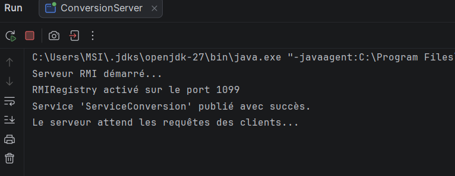

# TP 5 : Invocation des méthodes sur des objets distants avec Java RMI
## Activité 5-1 : Service de conversion de devise

**Membre du groupe :**
Ben Maalem Yassine
LSI3 3 G2

**Année universitaire :** 2026 – 2027  
**Matière :** Développement d'Applications Réparties

---

##  Objectif
Mettre en œuvre une communication client/serveur via Java RMI :
le serveur offre un service distant qui permet de convertir un montant en **Euros** vers **Dinars**.

##  Structure du projet
```
tp5/
├── RMIConversion_Server/
│   └── src/
│       ├── rmiService/
│       │   ├── IConversion.java        (Interface distante)
│       │   └── ConversionImpl.java     (Implémentation du service)
│       └── rmiServer/
│           └── ConversionServer.java   (Activation du RMIRegistry + publication)
│
├── RMIConversion_Client/
│   ├── libs/
│   │   └── conversionClient.jar        (JAR de l'interface exportée)
│   └── src/
│       └── rmiClient/
│           └── ConversionClient.java   (Lookup + invocation distante)
│
└── img/                                 (Captures d'écran)
```

##  Captures d'écran

### 1. Importation du `conversionClient.jar` dans le Classpath du client
Procédure : `File → Project Structure (Ctrl+Alt+Shift+S) → Modules → RMIConversion_Client → Dependencies → + → JARs or directories...`


### 2. Exécution du serveur RMI
Activation du RMIRegistry sur le port 1099 et publication du service `ServiceConversion`.



### 3. Résultat côté client
Le client cherche la référence distante via `Naming.lookup`, puis invoque `convertirMontant(500)`.


##  Synthèse
Ce TP nous a permis de comprendre le cycle de vie d'un service distant avec Java RMI :

1. **Définition de l'interface** : `IConversion` hérite de `Remote` et sa méthode `convertirMontant` lance `RemoteException`.
2. **Implémentation** : `ConversionImpl` hérite de `UnicastRemoteObject` pour exporter automatiquement l'objet distant.
3. **Enregistrement** : le serveur active l'annuaire `RMIRegistry` (port 1099) puis publie l'objet avec `Naming.rebind`.
4. **Invocation** : le client obtient la référence avec `Naming.lookup` et appelle la méthode distante comme une méthode locale.

L'export de l'interface seule dans `conversionClient.jar` et son ajout au Classpath du client garantissent
que le client ne dépend que de l'interface distante, ce qui illustre le principe de base des applications réparties.