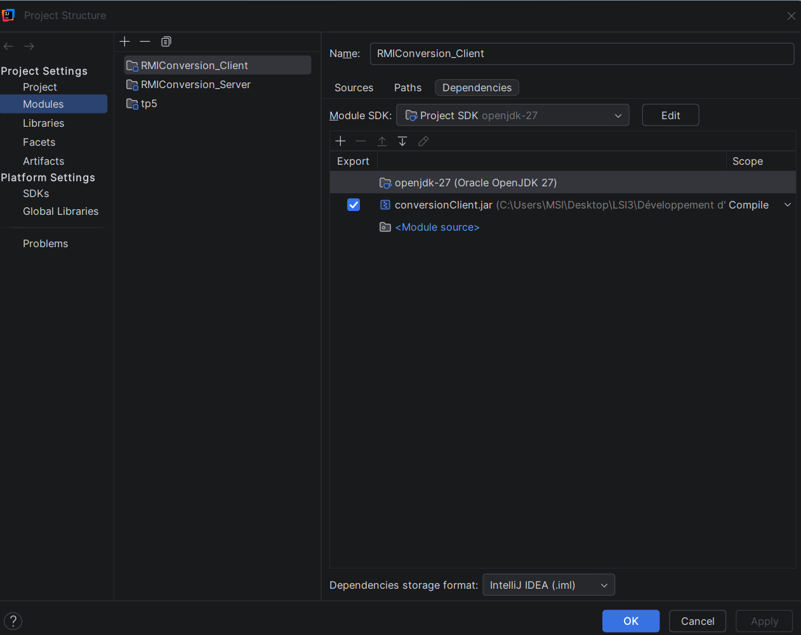
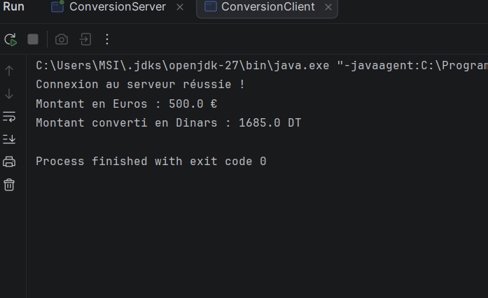

# TP 5 : Invocation des méthodes sur des objets distants avec Java RMI
## Activité 5-1 : Service de conversion de devise

**Membre du groupe :**
Ben Maalem Yassine
LSI3 3 G2

**Année universitaire :** 2026 – 2027  
**Matière :** Développement d'Applications Réparties

---

##  Objectif
Mettre en œuvre une communication client/serveur via Java RMI :
le serveur offre un service distant qui permet de convertir un montant en **Euros** vers **Dinars**.

##  Structure du projet
```
tp5/
├── RMIConversion_Server/
│   └── src/
│       ├── rmiService/
│       │   ├── IConversion.java        (Interface distante)
│       │   └── ConversionImpl.java     (Implémentation du service)
│       └── rmiServer/
│           └── ConversionServer.java   (Activation du RMIRegistry + publication)
│
├── RMIConversion_Client/
│   ├── libs/
│   │   └── conversionClient.jar        (JAR de l'interface exportée)
│   └── src/
│       └── rmiClient/
│           └── ConversionClient.java   (Lookup + invocation distante)
│
└── img/                                 (Captures d'écran)
```

##  Captures d'écran

### 1. Importation du `banqueClient.jar` dans le Classpath du client
Procédure : `File → Project Structure (Ctrl+Alt+Shift+S) → Modules → RMIConversion_Client → Dependencies → + → JARs or directories...`



### 2. Exécution du serveur RMI
Activation du RMIRegistry sur le port 1099 et publication du service `ServiceConversion`.


### 3. Résultat côté client
Le client cherche la référence distante via `Naming.lookup`, puis invoque `convertirMontant(500)`.



##  Synthèse
Ce TP nous a permis de comprendre le cycle de vie d'un service distant avec Java RMI :

1. **Définition de l'interface** : `IConversion` hérite de `Remote` et sa méthode `convertirMontant` lance `RemoteException`.
2. **Implémentation** : `ConversionImpl` hérite de `UnicastRemoteObject` pour exporter automatiquement l'objet distant.
3. **Enregistrement** : le serveur active l'annuaire `RMIRegistry` (port 1099) puis publie l'objet avec `Naming.rebind`.
4. **Invocation** : le client obtient la référence avec `Naming.lookup` et appelle la méthode distante comme une méthode locale.

L'export de l'interface seule dans `banqueClient.jar` et son ajout au Classpath du client garantissent
que le client ne dépend que de l'interface distante, ce qui illustre le principe de base des applications réparties.

-----

#  Activité 5-2 : Service de banque en utilisant RMI et JNDI


##  Objectif
Mettre en œuvre une communication client/serveur via Java RMI et comprendre
l'intégration entre **JNDI** et **RMI** pour l'enregistrement (binding)
et la recherche (lookup) des objets distants.

## * Structure du projet

```text
tp5/
├── RMIBanque_Server/
│   └── src/
│       ├── jndi.properties
│       ├── metier/
│       │   └── Compte.java
│       ├── rmiService/
│       │   ├── IBanque.java
│       │   └── BanqueImpl.java
│       └── rmiServer/
│           └── BanqueServer.java
│
├── RMIBanque_Client/
│   ├── libs/
│   │   └── banqueClient.jar
│   └── src/
│       ├── jndi.properties
│       └── rmiClient/
│           └── BanqueClient.java
```

## * Développement du serveur

### 1. Classe métier `Compte` (package `metier`)
Un compte est caractérisé par un code (int), un solde (double) et une date de création (Date).
La classe implémente `Serializable` car les objets Compte circulent sur le réseau
entre le client et le serveur.

```java
package metier;

import java.io.Serializable;
import java.util.Date;

public class Compte implements Serializable {
    private int code;
    private double solde;
    private Date dateCreation;

    public Compte(int code, double solde) {
        this.code = code;
        this.solde = solde;
        this.dateCreation = new Date();
    }

    public int getCode() {
        return code;
    }

    public double getSolde() {
        return solde;
    }

    public Date getDateCreation() {
        return dateCreation;
    }

    @Override
    public String toString() {
        return "Compte [code=" + code + ", solde=" + solde + ", dateCreation=" + dateCreation + "]";
    }
}
```

### 2. Interface distante `IBanque` (package `rmiService`)
L'interface distante hérite de `Remote` et chaque méthode lance `RemoteException`.
Elle expose les deux services distants : création et consultation d'un compte.

```java
package rmiService;

import java.rmi.Remote;
import java.rmi.RemoteException;
import metier.Compte;

public interface IBanque extends Remote {
    String creerCompte(Compte c) throws RemoteException;
    String getInfoCompte(int code) throws RemoteException;
}
```

### 3. Implémentation `BanqueImpl` (package `rmiService`)
La classe hérite de `UnicastRemoteObject` pour exporter l'objet distant.
Les comptes sont conservés côté serveur dans une `HashMap` :
`creerCompte` vérifie que le code n'existe pas déjà,
et `getInfoCompte` retourne les informations du compte à partir de son code.

```java
package rmiService;

import java.rmi.RemoteException;
import java.rmi.server.UnicastRemoteObject;
import java.util.HashMap;
import java.util.Map;
import metier.Compte;

public class BanqueImpl extends UnicastRemoteObject implements IBanque {

    private Map<Integer, Compte> comptes;

    public BanqueImpl() throws RemoteException {
        super();
        comptes = new HashMap<>();
    }

    @Override
    public String creerCompte(Compte c) throws RemoteException {
        if (comptes.containsKey(c.getCode())) {
            return "Le compte avec le code " + c.getCode() + " existe deja.";
        }
        comptes.put(c.getCode(), c);
        return "Compte cree avec succes : " + c.toString();
    }

    @Override
    public String getInfoCompte(int code) throws RemoteException {
        Compte c = comptes.get(code);
        if (c == null) {
            return "Aucun compte trouve avec le code " + code;
        }
        return c.toString();
    }
}
```

### 4. Configuration JNDI : fichier `jndi.properties` (dans `src`)
Au lieu d'utiliser directement `Naming`, l'application utilise JNDI.
Le fichier `jndi.properties`, placé dans `src` du serveur **et** du client,
configure l'environnement de l'`InitialContext` :
il indique la fabrique d'annuaire et l'adresse du registre RMI.

```properties
java.naming.factory.initial=com.sun.jndi.rmi.registry.RegistryContextFactory
java.naming.provider.url=rmi://localhost:1099
```

### 5. Serveur `BanqueServer` (package `rmiServer`)
Le serveur active le registre RMI sur le port 1099, crée une instance de `BanqueImpl`,
puis l'enregistre (binding) dans l'annuaire JNDI sous le nom `ServiceBanque`
à l'aide de l'objet `InitialContext`.

```java
package rmiServer;

import java.rmi.registry.LocateRegistry;
import javax.naming.InitialContext;
import rmiService.BanqueImpl;

public class BanqueServer {
    public static void main(String[] args) {
        try {
            System.setProperty("java.rmi.server.hostname", "localhost");
            LocateRegistry.createRegistry(1099);

            BanqueImpl serviceBanque = new BanqueImpl();

            InitialContext ctx = new InitialContext();
            ctx.bind("ServiceBanque", serviceBanque);

            System.out.println("Serveur RMI demarre avec JNDI.");
            System.out.println("Service 'ServiceBanque' enregistre avec succes.");
            System.out.println("En attente des requetes clients...");
        } catch (Exception e) {
            System.out.println("Erreur : " + e.getMessage());
            e.printStackTrace();
        }
    }
}
```

##  Développement du client

### 1. Export et import du JAR `banqueClient.jar`
Depuis le projet serveur, exportation des packages `rmiService` et `metier`
en sélectionnant **uniquement** l'interface `IBanque` et la classe `Compte`
(sans inclure `BanqueImpl`). Le fichier `banqueClient.jar` généré est enregistré
dans l'espace de travail, puis ajouté au Classpath du projet client
(dossier `libs/` + Dependencies du module). Ainsi, le client ne dépend
que de l'interface distante et de l'objet transférable.

### 2. Client `BanqueClient` (package `rmiClient`)
Le client n'utilise plus `Naming.lookup()` : il obtient la référence distante
via l'annuaire JNDI avec `InitialContext.lookup("ServiceBanque")`,
puis invoque les méthodes distantes (création de deux comptes,
tentative de doublon, consultation d'un compte existant et d'un compte inexistant).

```java
package rmiClient;

import javax.naming.InitialContext;
import metier.Compte;
import rmiService.IBanque;

public class BanqueClient {
    public static void main(String[] args) {
        try {
            InitialContext ctx = new InitialContext();
            IBanque serviceBanque = (IBanque) ctx.lookup("ServiceBanque");

            System.out.println("Connexion au serveur reussie via JNDI !");

            Compte c1 = new Compte(101, 5000);
            Compte c2 = new Compte(102, 12000);

            System.out.println("--- Creation des comptes ---");
            System.out.println(serviceBanque.creerCompte(c1));
            System.out.println(serviceBanque.creerCompte(c2));
            System.out.println(serviceBanque.creerCompte(c1));

            System.out.println("--- Consultation des comptes ---");
            System.out.println(serviceBanque.getInfoCompte(101));
            System.out.println(serviceBanque.getInfoCompte(102));
            System.out.println(serviceBanque.getInfoCompte(999));

        } catch (Exception e) {
            System.out.println("Erreur : " + e.getMessage());
            e.printStackTrace();
        }
    }
}
```

##  Exécution de l'application
Le serveur est démarré en premier, puis le client. Exemple de sortie obtenue :

**Console du serveur :**

```text
Serveur RMI demarre avec JNDI.
Service 'ServiceBanque' enregistre avec succes.
En attente des requetes clients...
```

**Console du client :**

```text
Connexion au serveur reussie via JNDI !
--- Creation des comptes ---
Compte cree avec succes : Compte [code=101, solde=5000.0, dateCreation=Sat Nov 14 10:23:45 CET 2026]
Compte cree avec succes : Compte [code=102, solde=12000.0, dateCreation=Sat Nov 14 10:23:46 CET 2026]
Le compte avec le code 101 existe deja.
--- Consultation des comptes ---
Compte [code=101, solde=5000.0, dateCreation=Sat Nov 14 10:23:45 CET 2026]
Compte [code=102, solde=12000.0, dateCreation=Sat Nov 14 10:23:46 CET 2026]
Aucun compte trouve avec le code 999
```

##  Synthèse
Cette activité a permis de comprendre l'intégration entre JNDI et RMI :

1. **Objet transférable** : la classe `Compte` implémente `Serializable`, elle est donc transmise **par valeur** (copie) entre le client et le serveur.
2. **Binding via JNDI** : au lieu de `Naming.rebind()`, le serveur enregistre l'objet distant avec `InitialContext.bind("ServiceBanque", objet)`, l'environnement JNDI étant configuré par le fichier `jndi.properties`.
3. **Lookup via JNDI** : au lieu de `Naming.lookup()`, le client obtient la référence distante (stub) avec `InitialContext.lookup("ServiceBanque")`.
4. **Découplage** : JNDI sépare le code applicatif du service de nommage ; changer d'annuaire ne demande que la modification de `jndi.properties`, sans toucher au code Java.
5. **Cycle de vie respecté** : interface distante (`Remote` + `RemoteException`), implémentation (`UnicastRemoteObject`), enregistrement (binding JNDI), puis invocation (lookup + appel distant).